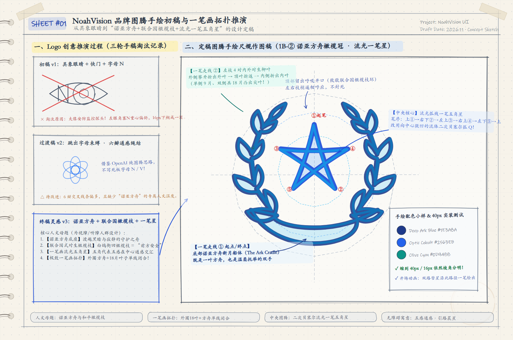
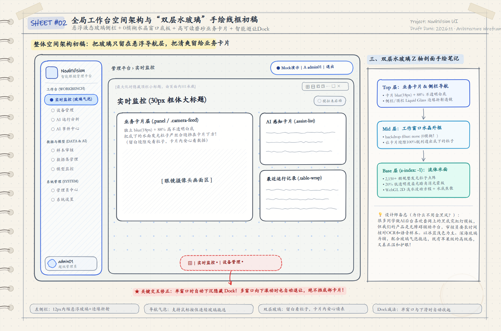
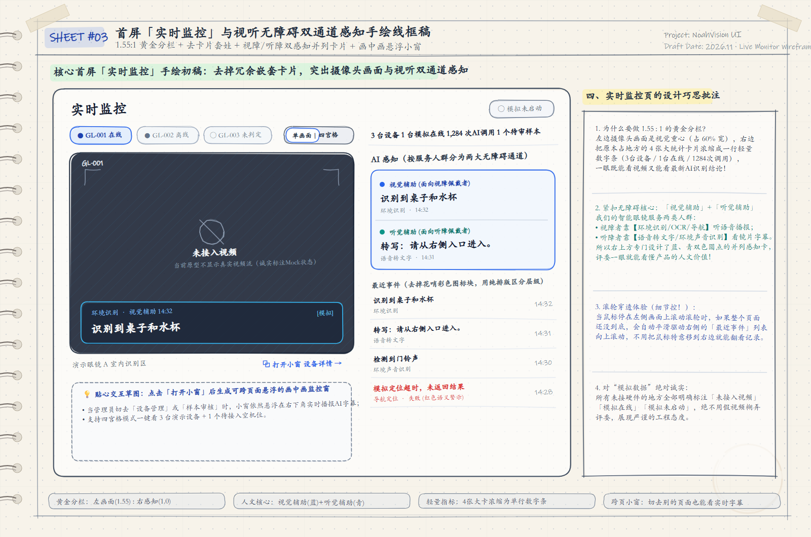
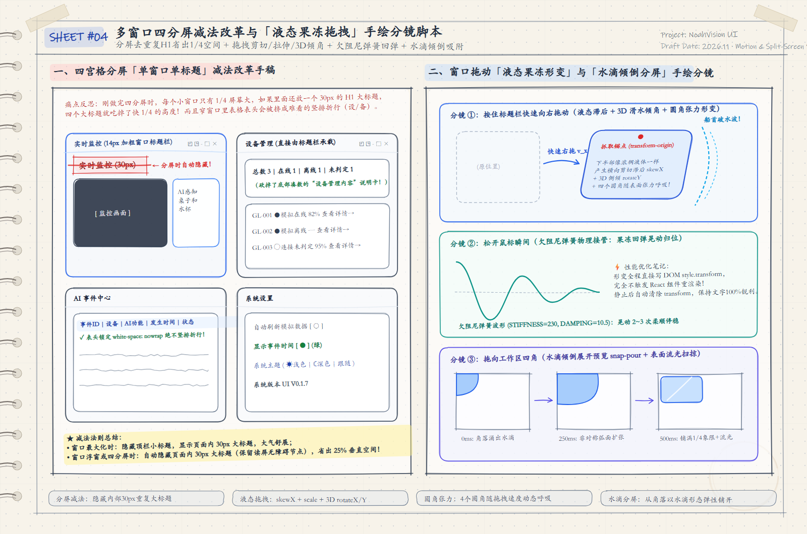
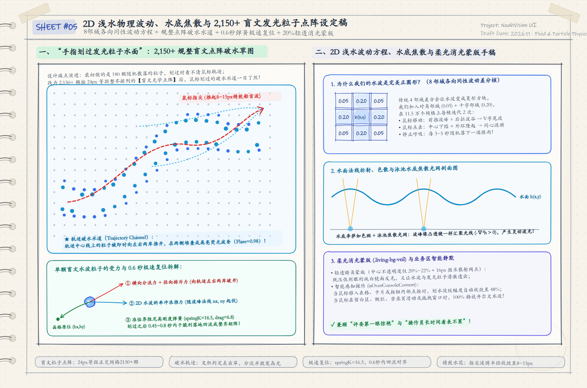

# NoahVision (V0.1.7) — UI 设计理念、手绘设计初稿与答辩指南 (`UIDesignConcept`)

本目录汇总了 **NoahVision（诺亚视界 · 智能眼镜管理平台）** 从创意发散、淘汰推演到最终定稿的 **5 张人类手绘速写初稿（`.png` + `.svg`）**、可离线翻阅的 **《手绘设计稿画册.html》**，以及 **3 份第一人称设计师手记与答辩速成文档**。

---

## 📚 核心文档导航

1. **[01-UI设计理念与视觉体系阐述（设计师手记版）.md](01-UI设计理念与视觉体系阐述（设计师手记版）.md)**  
   以设计师第一视角阐述：为什么拒绝冰冷的黑底霓虹安防风、如何从“视障盲文触点 + 听障水面涟漪”提炼出 2,150+ 发光粒子水面、如何用“双层水玻璃”解决粒子挡字矛盾、以及四分屏与 Dock 的空间减法。
2. **[02-五张手绘设计初稿逐张讲解指南.md](02-五张手绘设计初稿逐张讲解指南.md)**  
   逐张拆解下方 5 张手绘初稿的每一个区块、红笔打叉淘汰原因与手写批注细节。
3. **[03-UI设计师答辩速成宝典（自我陈述稿+评委追问满分话术）.md](03-UI设计师答辩速成宝典（自我陈述稿+评委追问满分话术）.md)**  
   包含 **90 秒 UI 设计师现场陈述逐字稿** 与 **6 个评委高频追问的满分回答话术**。
4. **[手绘设计稿画册（双击浏览器打开）.html](手绘设计稿画册（双击浏览器打开）.html)**  
   将 5 张手绘原稿装订为一体式画册，下载后双击即可在浏览器无损查看或打印。

---

## ✏️ 五张手绘设计初稿预览

### Sheet #01：NoahVision 品牌图腾手绘初稿与一笔画拓扑推演

### Sheet #02：全局工作台空间架构与“双层水玻璃”手绘线框初稿

### Sheet #03：首屏「实时监控」与视听无障碍双通道感知手绘线框稿

### Sheet #04：多窗口四分屏减法改革与「液态果冻拖拽」手绘分镜脚本

### Sheet #05：2D 浅水物理波动、水底焦散与 2,150+ 盲文发光粒子点阵设定稿

