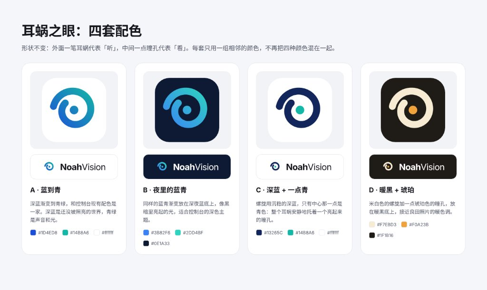
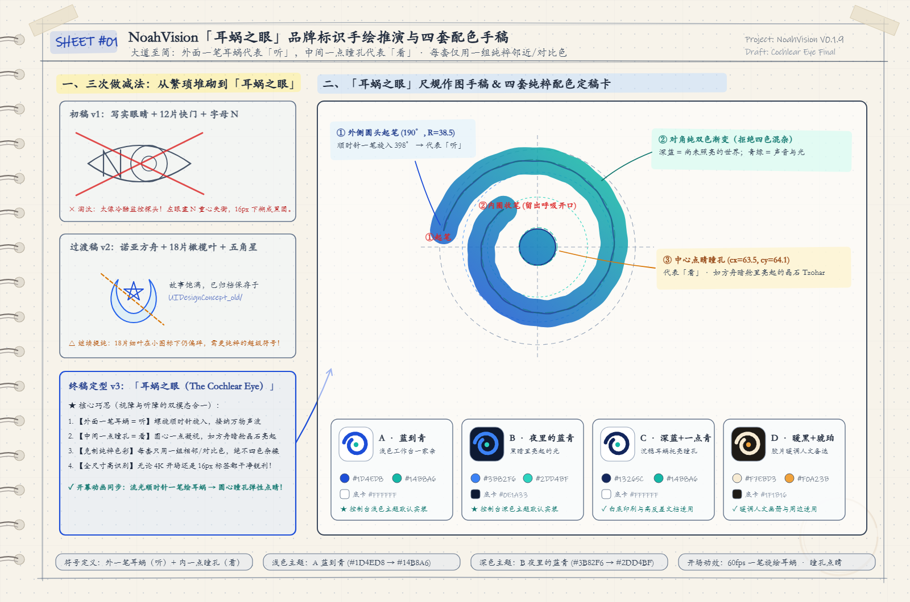
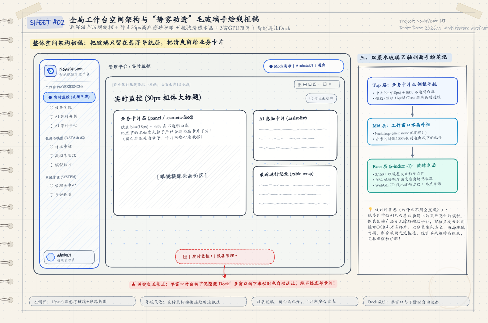
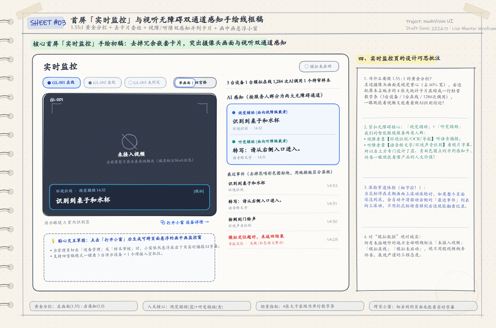
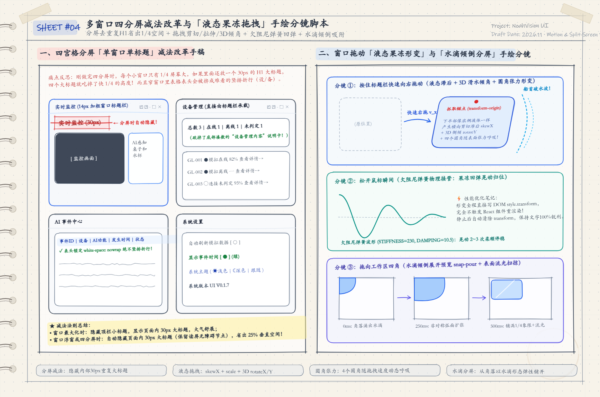
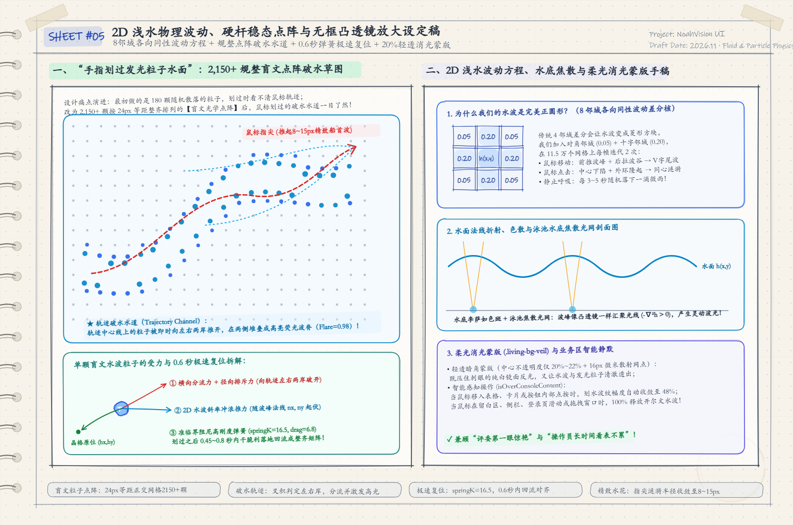

# NoahVision（诺亚视界 V0.1.9）— UI 设计理念、耳蜗之眼与手绘初稿集 (`UIDesignConcept_New`)

本目录汇总了 **NoahVision（诺亚视界 · 智能眼镜管理平台）** 最新升级后的 **「耳蜗之眼」品牌标识原样标准图集**、从创意淘汰推演到定稿的 **5 张人类手绘速写初稿（`.png` + `.svg`）**、可离线翻阅的 **《手绘设计稿画册（双击浏览器打开）.html》**，以及 **3 份第一人称设计师手记与答辩速成文档**（旧版方舟橄榄枝方案已完整归档于同级 `UIDesignConcept_old`）。

---

## 📚 核心文档导航

1. **[01-UI设计理念与视觉体系阐述（设计师手记版）.md](01-UI设计理念与视觉体系阐述（设计师手记版）.md)**  
   以设计师第一视角阐述：为什么拒绝冰冷的黑底霓虹安防风、如何将「听」与「看」提炼为极简符号 **「耳蜗之眼」**、如何用“静雾动透”毛玻璃与无框凸透镜点阵兼顾美感与零干扰阅读、以及四维动态分析图表与多窗口防闪屏设计。
2. **[02-五张手绘设计初稿逐张讲解指南.md](02-五张手绘设计初稿逐张讲解指南.md)**  
   逐张拆解下方 5 张手绘初稿的每一个区块、红笔打叉淘汰原因与手写批注细节。
3. **[03-UI设计师答辩速成宝典（自我陈述稿+评委追问满分话术）.md](03-UI设计师答辩速成宝典（自我陈述稿+评委追问满分话术）.md)**  
   包含 **90 秒 UI 设计师现场陈述逐字稿** 与 **6 个评委高频追问的满分回答话术**。
4. **[手绘设计稿画册（双击浏览器打开）.html](手绘设计稿画册（双击浏览器打开）.html)**  
   将 5 张最新手绘原稿装订为一体式画册，下载后双击即可在浏览器无损查看或打印。

---

## 🌟 「耳蜗之眼」品牌 Logo 原样标准图集（高清 `.png` + 无损矢量 `.svg`）

> **形状不变：外面一笔耳蜗代表「听」，中间一点瞳孔代表「看」。每套只用一组相邻或纯粹对比的颜色。**

- **[Logo原图00-耳蜗之眼-四套配色设计规范原图.jpg](Logo原图00-耳蜗之眼-四套配色设计规范原图.jpg)**（四套配色标准总览卡原图）
- **[Logo原图01-耳蜗之眼A-蓝到青（浅色主题定稿）.png](Logo原图01-耳蜗之眼A-蓝到青（浅色主题定稿）.png)**（`1200×1200` · `#1D4ED8 → #14B8A6` 白底圆角卡，控制台浅色主题实装，附 `.svg`）
- **[Logo原图02-耳蜗之眼B-夜里的蓝青（深色主题定稿）.png](Logo原图02-耳蜗之眼B-夜里的蓝青（深色主题定稿）.png)**（`1200×1200` · `#3B82F6 → #2DD4BF` 深夜蓝 `#0E1A33` 底卡，控制台深色主题实装，附 `.svg`）
- **[Logo原图03-耳蜗之眼C-深蓝加一点青.png](Logo原图03-耳蜗之眼C-深蓝加一点青.png)**（`1200×1200` · 沉稳深蓝 `#13265C` 耳蜗托起青色 `#14B8A6` 瞳孔，附 `.svg`）
- **[Logo原图04-耳蜗之眼D-暖黑加琥珀.png](Logo原图04-耳蜗之眼D-暖黑加琥珀.png)**（`1200×1200` · 米白 `#F7EBD3` 螺旋配琥珀 `#F0A23B` 瞳孔、暖黑 `#1F1B16` 底卡，附 `.svg`）
- **[Logo原图05-耳蜗之眼-透明底无框图腾（浅色PPT专用）.png](Logo原图05-耳蜗之眼-透明底无框图腾（浅色PPT专用）.png)**（`1200×1200` 真透明通道，附 `.svg`）
- **[Logo原图06-耳蜗之眼-透明底无框图腾（深色PPT专用）.png](Logo原图06-耳蜗之眼-透明底无框图腾（深色PPT专用）.png)**（`1200×1200` 真透明通道，附 `.svg`）

---

## ✏️ 五张手绘设计初稿预览

### Sheet #01：NoahVision「耳蜗之眼」手绘推演与四套配色定稿手稿

### Sheet #02：全局工作台空间架构与“静雾动透”玻璃手绘线框稿

### Sheet #03：首屏「实时监控」与视听无障碍双通道感知手绘线框稿

### Sheet #04：多窗口四分屏减法改革与「液态果冻拖拽」手绘分镜脚本

### Sheet #05：2D 浅水物理波动、无框凸透镜点阵与多维动态图表设定稿

